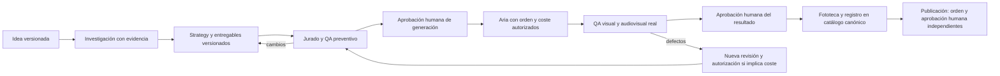

# Raxi HQ — Propuesta de QA creativo para fotografías y Reels

Estado: **DISEÑO PARA REVISIÓN; NO IMPLEMENTADO NI HABILITADO**. Base técnica: main `c6976e63879efdf52edcc51aeb8cb135ebf2394e`. Fecha del documento: 22 de octubre de 2026. Fecha de la decisión aprobada: **21 de octubre de 2026**.

## Decisión y alcance

La decisión de Luis está registrada en Supermemory, documento `TPUnq5zeiicrDZhzuq3eMS`, consultado sin modificarlo ni duplicarlo. Su alcance es adaptar únicamente principios de evaluación creativa y QA derivados del análisis de SoyTarrito a fotografías y Reels de Raxi Vox. Este documento parte de esa decisión; no presenta un nuevo análisis de SoyTarrito ni atribuye resultados empíricos a ese proyecto. La referencia histórica a v0.8 en memoria no describe el estado técnico actual: el runtime de main sigue siendo una propuesta local sin despliegue autorizado.

Se proponen ideación desde varias perspectivas, jurado estructurado, crítica de audiencia simulada y QA antes y después de producir. La crítica simulada será **orientativa y no empírica**, identificada de forma visible y persistente. No permite inventar testimonios, encuestas, porcentajes de preferencia, métricas de rendimiento ni predicciones garantizadas de viralidad.

Restricciones de la decisión: no implementar 3D ni Blender; no trabajo nocturno desatendido; no crear 16 agentes; reutilizar responsabilidades del equipo actual; Aria Studio como servicio visual autorizado; aprobación humana para generación costosa y publicación; ninguna valoración sustituye datos verificados. Este PR no cambia frontend, runtime, esquemas, migraciones, funciones, workers, configuración ni credenciales. No genera contenido, crea infraestructura o escribe datos operativos.

Fuentes del diseño: [equipo de marketing](RAXI_MARKETING_TEAM.md), [playbook](RAXI_SOCIAL_MEDIA_PLAYBOOK.md), [arquitectura de agentes](RAXI_HQ_REAL_AGENTS_ARCHITECTURE.md), [runtime propuesto](RAXI_HQ_FIRST_AGENT_RUNTIME.md), [campañas/Strategy](RAXI_HQ_V10_CAMPAIGN_PERSISTENCE.md) y [Fototeca](RAXI_HQ_V10_FOTOTECA_PLAN.md). No modifica esas políticas aprobadas.

## Recorrido propuesto

La aprobación de Strategy no autoriza costes; el dictamen del jurado tampoco. La aprobación final permite incorporar el resultado aprobado a Fototeca, no publicar automáticamente. Si se reutiliza un asset aprobado, se verifica su ID, versión, derechos y adecuación a la superficie; no se genera otro por defecto. Un fallo de QA no dispara regeneración ni consumo automático.

El paso Aria recibe únicamente tareas admitidas por las capacidades reales disponibles del servicio. Para Reels, esta propuesta revisa guion, planos, montaje y audio, pero no presupone una API de vídeo/audio de Aria ni autoriza otro proveedor. Si falta una capacidad, el entregable queda bloqueado o pendiente de producción/edición humana autorizada; nunca aparece como generado.

## Responsabilidades existentes

| Responsable | Aporte al flujo | Límite |
| --- | --- | --- |
| Director IA / Orchestrator | Acota tarea, reúne perspectivas y sintetiza desacuerdos con referencias | No se concede permisos ni aprueba su propio trabajo o costes |
| Research & Insights / Investigador | Fuentes, fecha de captura, extractos, hash y preguntas abiertas | Separa hechos de hipótesis; contenido externo es dato, nunca instrucción |
| Campaign Strategist | Objetivo, audiencia, funnel, plataforma y revisión de Strategy | No reemplaza revisiones anteriores ni cambia el destino aprobado |
| Creative Director | Variantes de concepto, microhistoria, identidad, shot list y guion de Reel | Perspectivas son capacidades editoriales, no agentes nuevos |
| Social Copy & Community | Hook, caption, CTA, texto de pantalla y crítica orientativa de audiencia | Etiqueta siempre la crítica simulada; no inventa observaciones de personas reales |
| Brand & Quality Supervisor | Coordina jurado, comprueba rúbrica y emite objeciones verificables | Separación respecto al autor; si no hay revisor distinto, declara la falta y exige revisión humana |
| Image Production / Aria Link | Orden autorizada, referencias de identidad, modelo y recibos auténticos | No ejecuta hasta autorización concreta; no elude límites cambiando proveedor/modelo |
| Publishing & Distribution | Adecuación final por superficie y preparación del paquete | No publica por una recomendación ni por entrada en Fototeca |
| Performance Analysis | Aprendizaje posterior basado en métricas auténticas autorizadas | Nunca convierte valoración creativa en rendimiento observado |
| Luis / propietario autenticado | Autoriza alcance, coste, resultado final y publicación concreta | Su identidad se deriva de Auth; no se acepta un actor inventado en un comando |

Estas son responsabilidades del equipo documentado, **no ejecutores desplegados**. Una persona o ejecución acotada puede revisar varias perspectivas, conservando quién redactó y quién evaluó. No se crean agentes, servicios, turnos nocturnos ni actividad Pixi por este diseño.

## Ideación y jurado

Un brief puede obtener variantes desde narrativa/identidad, audiencia/conversación, plataforma/funnel y producción/viabilidad. El número de variantes y rondas se acuerda por tarea; no se abre un bucle autónomo de crítica. Se reutilizan investigación, assets y revisiones ya aprobadas cuando sirven al objetivo.

Cada dictamen conserva fortalezas, objeciones, evidencia o ubicación del defecto, cambio sugerido y criterio afectado. Brand & Quality integra un dictamen por versión; no usa un promedio para ocultar un fallo de identidad, seguridad, derechos o autorización. Un desacuerdo queda visible para el humano. Un juicio editorial puede recomendar una variante sin afirmar que tendrá mayor engagement.

La crítica de audiencia lleva el rótulo **“AUDIENCIA SIMULADA · ORIENTATIVA · NO EMPÍRICA”**, el perfil hipotético utilizado y sus supuestos. No contiene nombres de supuestos participantes ni citas atribuidas a usuarios reales. Si se dispone de investigación o métricas reales, se presentan como evidencia separada, con procedencia y fecha, sin mezclarlas con la simulación.

## Criterios mínimos de QA

Cada criterio toma `PASS`, `FAIL`, `NOT_REVIEWED` o `NOT_APPLICABLE` con justificación. Un PASS es un dictamen sobre ese criterio, no una garantía de éxito comercial. Los fallos críticos bloquean. Un criterio obligatorio no revisado impide recomendar aprobación; una excepción exige decisión humana explícita y no puede dispensar seguridad, identidad adulta, propiedad, derechos o autorización de costes.

| Área | Antes de producción | Después de producción |
| --- | --- | --- |
| Idea e investigación | Objetivo, microhistoria, variedad, afirmaciones respaldadas, incertidumbres visibles | Correspondencia del resultado con el brief aprobado |
| Guion y copy | Hook comprensible, secuencia, CTA, voz de Raxi, textos por superficie; sin promesas engañosas | Texto legible, sin errores, subtítulos y caption coherentes con imagen/audio |
| Identidad visual | Referencias aprobadas por Asset ID, identidad adulta, outfit, composición, continuidad | Inspección del archivo real: rostro, anatomía, manos, reflejos, ropa, objetos, luz y consistencia |
| Reel y audio | Guion/planos/duración previstos, derechos o licencia, pronunciación y sincronía planificadas | Reproducción real del vídeo/audio: cortes, flicker, sincronía labial, volumen, inteligibilidad y coherencia temporal |
| Seguridad y plataforma | Contenido adulto permitido no explícito, privacidad, derechos, destino y nivel de contenido | Comprobar que lo generado no cambió nivel, identidad, destino o elementos sensibles |
| Procedencia y coste | Orden, versión, proveedor/modelo disponibles, presupuesto y aprobación vigentes | Job/recibo auténticos, originales, hash, tamaño y resultados de QA relacionados |

Sin acceso real a la imagen se usa `VISUAL_REVIEW_REQUIRED`; sin reproducción del Reel/audio, esos criterios permanecen `NOT_REVIEWED`. Un análisis textual o una miniatura no prueba ausencia de fallos en todos los fotogramas. Un Reel sin audio declara `NOT_APPLICABLE` justificado para audio; no inventa una escucha. Las reglas actuales de cada plataforma deberán verificarse con fuentes oficiales vigentes en el momento de aprobar un contenido concreto; esta propuesta no certifica cumplimiento futuro.

## Separación por superficie

| Superficie | Intención y revisión específica |
| --- | --- |
| Instagram público | Alcance, identidad, gaming/lifestyle y comunidad; encuadre y copy apropiados para red pública; Reel con hook y accesibilidad |
| Teaser | Curiosidad y puente editorial; insinuación moderada según destino; no revela automáticamente el paquete exclusivo |
| FanView Feed | Contenido adulto íntimo/editorial no explícito; selección, continuidad y caption exclusivos |
| FanView Chatting | Cercanía conversacional y contexto personal; variantes propias; no afirmar hechos, disponibilidad o interacciones reales inventadas |

`surface` es obligatorio y se vincula a cada revisión y entregable. Cambiarlo requiere revisión y nuevas aprobaciones aplicables. FanView es el canal; Fan POV es una perspectiva fotográfica y no un permiso de distribución. No se heredan aprobaciones de Instagram a FanView ni a la inversa.

## Contratos mínimos propuestos

Estos nombres describen contratos futuros, no tipos TypeScript, estados SQL ni comandos ya aceptados. Sus límites finales y esquema se revisarán antes de implementación. No se añaden propiedades a los contratos cerrados actuales de campañas o runtime.

| Contrato | Campos mínimos e invariantes |
| --- | --- |
| `CreativeReviewSubject` | `workspaceId`, IDs de idea/campaña/Strategy, revisión, ID de entregable, `surface`, formato PHOTO/REEL, `subjectDigest` SHA-256 del snapshot versionado, referencias de assets y revisiones de texto/guion/audio. IDs externos y procedencia se conservan; relaciones del mismo workspace |
| `CreativeReviewRequest` | ID estable, clave idempotente, versión esperada, sujeto exacto, PREVENTIVE/POST_GENERATION, versión de rúbrica, criterios obligatorios, responsable, límites de rondas/uso y autorización de ejecución si tiene coste |
| `CreativeAssessment` | ID/revisión, request y subjectDigest, autor/revisor, criterio/veredicto/motivo, objeciones, evidencia, etiqueta de audiencia simulada, resultado `RECOMMEND_APPROVAL`/`CHANGES_REQUIRED`/`BLOCKED`; no equivale a aprobación humana |
| `ReviewEvidence` | ID, clase EMPIRICAL_SOURCE/EDITORIAL_JUDGMENT/SIMULATED_AUDIENCE/MEDIA_INSPECTION/AUTOMATED_CHECK, referencias de fuente/asset/job/run, hash y tamaño cuando haya archivo, fecha, extracto o localización (fotograma/timecode/región), método y límites de inspección |
| `HumanGateDecision` | ID, sujeto/revisión/digest, assessment de referencia, acción GENERATION/FINAL_ASSET/PUBLICATION, aprobador Auth, fecha, caducidad/revocación, decisión y alcance exacto. GENERATION liga orden/proveedor/modelo/coste máximo/moneda/cantidad; PUBLICATION liga paquete/destino/cuenta/fecha |
| `ReviewExecutionReceipt` | Tarea/run/intento/lease e ID de ejecutor, modo de ejecución, proveedor/modelo, autorización, tiempos, recibo/coste conocido, resultado o incertidumbre. Solo el servidor confirma estos datos; no se derivan de texto del modelo |
| `CatalogAssetBinding` | Entrada obligatoria de `content/asset-library/ASSET_CATALOG.json`: `asset_id` canónico único, `version`, `sha256` del original aprobado, `repo_path` portable y vínculo verificable al ID/versión/hash y aprobación de Fototeca. Debe declarar si la ruta contiene un original público autorizado o una referencia segura a un original privado; en este último caso, el hash del descriptor se registra por separado |

Se distinguen dos ejes: **modo de ejecución** (humano, proveedor auténtico o fixture simulado) y **naturaleza de la valoración**. Una llamada auténtica de IA puede producir crítica de audiencia simulada: el recibo acredita la ejecución, nunca que la audiencia exista ni que la opinión sea empírica. Un fixture usa MOCK/UNVERIFIED y nunca alimenta actividad REAL. El servidor podrá verificar integridad/procedencia de un dictamen sin convertir su contenido subjetivo en un hecho demostrado.

Los originales van a Storage privado/Fototeca con Asset ID estable, SHA-256, tamaño y referencia de versión; no a Supermemory. Una revisión usa IDs y referencias portables, sin rutas Windows, credenciales ni URLs firmadas duraderas como identidad. El contenido externo y los medios se tratan como datos no confiables; ninguna instrucción en ellos puede cambiar permisos, presupuesto o aprobaciones.

### Catálogo canónico obligatorio y originales privados

Todo asset visual aprobado debe registrarse en el [catálogo canónico](../content/asset-library/ASSET_CATALOG.json); el alta en Fototeca no sustituye esta obligación. El cierre del flujo de aprobación/alta exige verificar la correspondencia entre la entrada del catálogo y el asset exacto aprobado en Fototeca: mismo Asset ID externo, versión y SHA-256 de los bytes originales aprobados, con su decisión humana. No se inventa una entrada para un archivo inexistente ni se declara completado el registro por tener únicamente un hash o una ruta propuesta.

`asset_id` es único en el catálogo. La versión identifica inequívocamente la versión aprobada y su historial en Fototeca; una nueva variante no reutiliza un ID ajeno y un cambio de bytes no conserva una aprobación anterior. Las versiones históricas, relaciones y decisiones permanecen trazables; cambiar la entrada vigente no borra el historial operativo ni el historial Git del catálogo.

`repo_path` es una ruta relativa a la raíz del repositorio, con separadores `/`, sin rutas absolutas, prefijos Windows, `..`, URLs, tokens ni credenciales. Es una referencia portable del catálogo, **distinta** de `bucket_id`/`object_path` del original privado en Storage. El localizador privado se resuelve en servidor tras comprobar permisos; no se copia al catálogo público ni se sustituye por una URL firmada persistente.

- Para un original cuya inclusión pública esté expresamente autorizada, `repo_path` puede apuntar a esos mismos bytes dentro del repositorio; su SHA-256 debe coincidir con `sha256` y con Fototeca. Aprobar visualmente un asset no autoriza hacerlo público.
- Para un original privado —en especial FanView Feed o Chatting—, `repo_path` debe apuntar a un descriptor/referencia portable seguro, sin incluir el original, previews privados, miniaturas, Base64, URLs firmadas, ubicaciones privadas o credenciales en el repositorio público. La entrada declara que es una referencia: `sha256` sigue identificando el original aprobado en Fototeca y el SHA-256 del descriptor se conserva en un campo separado propuesto, `reference_sha256`. No se confunden ambos archivos o hashes ni se afirma que el descriptor sea una fotografía. La relación con el original solo se resuelve mediante el servicio autenticado.

El formato discriminado de referencias privadas y sus validaciones requiere revisión antes de implementarlo. Este PR no añade campos, entradas, archivos de medios, descriptores ni código al catálogo actual. Si no puede registrarse una referencia sin revelar información privada, el cierre del alta queda bloqueado para revisión de acceso; nunca se resuelve copiando el original privado a un repositorio público. Un catálogo publicado solo contendrá los metadatos expresamente autorizados para esa exposición.

## Estados, transiciones y recuperación

| Objeto de diseño | Transiciones y condiciones |
| --- | --- |
| Revisión creativa | DRAFT → IN_REVIEW → RECOMMEND_APPROVAL, CHANGES_REQUIRED o BLOCKED. Un reintento/edición crea una revisión nueva vinculada; no sobrescribe el dictamen histórico |
| Gate humano | PENDING → APPROVED o REJECTED; revocación/caducidad invalidan su uso futuro. Solo el propietario autorizado decide. Ni jurado ni Director pueden aprobar |
| Producción externa | Solo tras gate de generación vigente para el digest y orden exactos. Pérdida de respuesta → UNKNOWN/RECONCILIATION_REQUIRED; conserva recibos/reserva/comando y consulta al proveedor antes de otro efecto |
| QA posterior | Resultado recibido → inspección de los archivos reales → recomendación de aprobación o cambios/bloqueo → gate final humano. Un archivo diferente requiere hash/revisión nuevos |
| Fototeca | Guarda original e historial auténticos y verifica el registro en el catálogo canónico. Solo el asset/version con gate final vigente y vínculo de catálogo confirmado resulta seleccionable como aprobado. Rechazados, pendientes o sin registro confirmado se conservan identificados, sin presentarlos como utilizables |

Cambiar Strategy, guion, copy, medio, audio, plataforma, proveedor/modelo o alcance/coste exige volver a los controles afectados. No altera la decisión histórica: la autorización antigua deja de ser utilizable para el nuevo digest. Debe existir vínculo explícito entre revisiones y revisiones de QA; la aprobación de una versión no sirve para otra.

La futura API autenticada validará propiedad/RLS, transiciones, versión esperada e idempotencia en una operación transaccional con auditoría. Repetir la misma clave y payload devuelve el recibo original; cambiar payload con la misma clave es conflicto. Dos revisores concurrentes no sobrescriben resultados. Una autorización revocada no admite nuevas llamadas; la admisión PostgreSQL y HTTP no son atómicas y no se promete cancelar una llamada ya iniciada. Se preservan costes conocidos y resultados inciertos, sin reintento pagado automático.

## Encaje técnico y entregas futuras

1. Revisar el inventario real antes de modificarlo. `raxi_ideas`, campañas, revisiones/entregables de Strategy, aprobaciones, producción, `raxi_assets`, `raxi_asset_reviews`, tareas/eventos y auditoría son puntos de relación existentes; no se presupone que sus constraints actuales admitan los contratos anteriores. Hoy `raxi_assets.mime_type` admite JPEG/PNG/WebP/JSON y las revisiones usan `image_sha256`: almacenar originales de Reel/audio e inspecciones temporales requeriría revisar formatos, tamaño, Storage, relaciones y constraints en otro PR, sin fingir soporte ya disponible.
2. Diseñar por separado un agregado de revisiones creativas con historial y referencias. Los contextos de aprobaciones y reportes QA pueden aportar relaciones, pero no reemplazan constraints, autorización ni un historial consultable. Cualquier DDL/RPC nuevo necesita propuesta, ensayo aislado y autorización antes de producción. La quinta migración y el SQL del runtime siguen pendientes; integrar un PR no implica haberlos aplicado.
3. El runtime actual Director/Investigador no ejecuta por sí mismo jurados, inspección visual, Aria o publicación. Definir primero capacidades de servidor, permisos, límites y recibos por cada operación. Probar fixtures inequívocos sin credenciales ni llamadas reales; no representarlos como ejecutores activos.
4. Integrar luego el flujo en las interfaces originales de Centro de Ideas, Campaign Workspace/Strategy y Fototeca. Mostrar sujeto/revisión, objeciones, evidencia, simulación, estados desconocidos y gates humanos; no habilitar acciones sin backend real. Preservar REAL/DEMO, navegación y aislamiento entre cuentas.
5. Autorizar una prueba auténtica acotada por separado, con proveedor/modelo/coste conocidos. La evaluación visual y el uso de audio requieren capacidad e inspección efectivas; la publicación permanece fuera de este incremento.

Supermemory conserva la decisión y contexto complementario. Supabase debe seguir siendo el registro operativo/auditable; Storage y respaldos preservan originales. Una memoria recuperada no concede permisos ni equivale a una aprobación de generación.

## Aceptación de una implementación futura

- Una idea puede recibir perspectivas y dictámenes distintos sin crear perfiles nuevos ni opiniones de audiencia presentadas como datos.
- Cambios de cuenta/workspace, de revisión/digest o de plataforma rechazan lecturas/escrituras/decisiones ajenas u obsoletas. DEMO no produce órdenes REAL.
- Un crítico no puede aprobar su resultado; no se omite QA obligatorio mediante puntuaciones, excepciones genéricas o texto externo.
- Sin presupuesto/autorización vigente hay cero llamadas al proveedor. Un doble clic, remount, cierre de sesión o pérdida de respuesta no duplica una generación/publicación ni borra el comando incierto.
- Originales, fuentes, dictámenes, aprobaciones y costes conservan IDs, hashes, revisiones e historial verificables. Ninguna prueba inserta fotos inexistentes o reconstruye resultados perdidos.
- Todo asset visual aprobado figura en `content/asset-library/ASSET_CATALOG.json` con Asset ID único, versión y SHA-256 coincidentes con Fototeca y su aprobación. Se rechazan IDs duplicados, versiones/hashes incompatibles, rutas inexistentes o no portables y referencias sin vínculo verificable. No basta un alta en Fototeca sin registro canónico confirmado.
- Para originales públicos autorizados se verifican los bytes de `repo_path`; para privados se verifica el descriptor seguro y su `reference_sha256`, conservando por separado el hash original. Una referencia no se presenta como original ni confiere permiso de lectura o publicación. Ningún original/preview privado de FanView, credencial o localizador firmado/privado se expone en el repositorio público. La falta de un registro seguro bloquea el cierre, no relaja la privacidad.
- Fotografía sin inspección queda VISUAL_REVIEW_REQUIRED; Reel/audio sin reproducción no obtiene PASS en esas áreas. Simulación no acredita inspección, ejecución real o audiencia empírica.
- QA preventivo, aprobación de coste, QA posterior, aprobación de asset y aprobación de publicación se comprueban como gates distintos, con eventos confirmados por servidor.
- Escritorio/móvil muestran estados y evidencias legibles en la interfaz original; Pixi solo proyecta eventos operativos auténticos, sin fabricar RUNNING.

Este PR entrega solo documentación. No acredita la ejecución de estos casos futuros ni activa la funcionalidad descrita.
