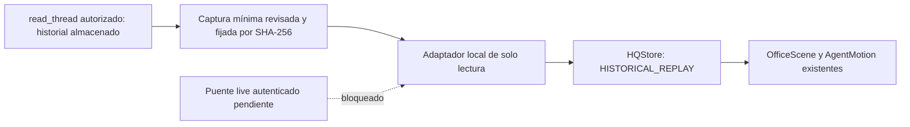

# Observación de ejecuciones — PR #18

Base: main `1ec48d7509bb44de84265d2ee77fa9ed8f8d339c`, posterior al merge de #17. **Avance parcial: reproducción histórica auténtica; actividad en vivo bloqueada.** No habilita el host supervisado, proveedores, workers ni persistencia de recibos.

## Arquitectura comprobada

Se reutilizan HQStore, HQState/HQEvent, OfficeScene, AgentMotion, las estaciones y los controles de cámara. Pixi recibe snapshots y emite selección; no consulta ejecutores ni concede permisos. Los contratos de #17 siguen locales y desactivados. No se añade otro runtime, ledger, cola, base de datos ni canvas.

El único nuevo origen admitido es una captura concreta de metadatos de Codex. No existe selector de URLs, carga de archivos arbitrarios ni lectura del historial privado desde el navegador. Los datos versionados son deliberadamente publicables y están limitados a IDs, estado, tiempos y un comando sin texto/salida. No se incluyen mensajes, razonamiento, conversaciones, rutas privadas, credenciales ni resultados del modelo.

## Capacidades reales y límites

| Interfaz | Documentación / comprobación | Frecuencia y limitación |
| --- | --- | --- |
| Codex desktop `read_thread` | Herramienta disponible y consultada; devolvió turno completado e IDs de comandos | Snapshot manual del historial. No es suscripción ni acredita frescura live |
| Codex App Server | [Referencia oficial](https://learn.chatgpt.com/docs/app-server): `thread/read` no suscribe; hay notificaciones `turn/started` y `turn/completed` | Interfaz documentada; **sin puente autorizado comprobado** entre la instancia desktop y HQ. No se inició un servidor |
| `codex exec --json` | [Modo no interactivo oficial](https://learn.chatgpt.com/docs/non-interactive-mode): eventos JSONL de una ejecución | Iniciaría trabajo nuevo. No se ejecutó para esta demostración |
| Runtime propio de Raxi | Coordinador y contratos existentes, simulaciones identificadas | No se activó host, worker, proveedor ni transporte real |
| Munder | Adaptador existente independiente | Desconectado en este ensayo; no se atribuyen sus capacidades a Codex |

No se encontró una interfaz MCP de Codex que suministre una suscripción en vivo utilizable por esta aplicación. Leer resúmenes/historial o esperar a un chat no equivale a consumir un flujo autenticado de eventos. No se inspeccionaron secretos, bases privadas o archivos de rollout para fabricar una integración alternativa.

## Evidencia auténtica y alcance de identidad

- Thread: `01a1559f-dfe9-7d31-90d3-b4fff0820615`.
- Turn/run: `01a1701c-eac4-77b3-9075-1abe7031876d`, completado.
- Inicio: `2026-10-24T22:51:46.000Z`; finalización: `2026-10-24T22:57:11.000Z`.
- Comando relacionado: `exec-4cfd1881-2a6e-4c04-95d8-c61b98ba4855`, completed, exit 0, 217843 ms. Su cwd observado correspondía al checkout aislado del PR #17; no se infiere la asociación desde el cwd general del thread.
- Ejecutor derivado: `codex:local:<threadId>`; etiqueta **Codex · ejecutor observado**, rol **EXTERNAL_EXECUTOR**. Es una identidad de observación, no una identidad autenticada de un agente Raxi.
- Task ID de Raxi y agente asignado: **no observados**, permanecen null. El turno no se atribuye al Director ni al Investigador.

Las dos observaciones se derivan de los campos nativos `startedAt` y `completedAt`. Las referencias `codex://threads/<thread>/turns/<turn>#<campo>` identifican esos campos para contrastarlos con `read_thread`; no son IDs de notificaciones push ni se promete que sean enlaces navegables. No se inventan asignación, progreso, entrega de resultado, aprobación ni pensamientos. Un turno completado tampoco demuestra por sí solo calidad del resultado, factura o recibo persistido.

La huella fija del texto UTF-8 es `f433a8e8874b0fe89e188853333e766829d4278b72c0e7f1f92c716e37fe7498`. Es un **pin de integridad de una captura revisada**, no firma del proveedor ni autorización alojada. La autenticidad de origen se comprobó mediante la lectura first-party; un revisor con acceso puede repetirla. Publicar otro origen requerirá captura mínima, revisión de procedencia y actualización explícita del pin.

## Política de admisión y aislamiento

`admitReviewedCapture` captura bytes antes del await, comprueba tamaño máximo, SHA-256 fijo y contrato cerrado. Se rechazan propiedades adicionales, origen/proyecto/thread/run/ejecutor distintos, asignaciones inventadas, fechas inválidas, iguales o invertidas y evidencia de comando incompatible. La salida y sus eventos se congelan; la proyección solo acepta objetos admitidos por el adaptador.

La captura no puede declararse LIVE ni aportar su propio digest. Se admite una sola secuencia, inicio y finalización; los pasos manuales no repiten la finalización. Solicitudes de carga simultáneas y lecturas anteriores se invalidan por generación. No se ordenan ni reparan datos inválidos silenciosamente.

App toma el viewer de la sesión existente y liga la observación local a viewer/proyecto. El cambio de cuenta, cierre de sesión, desmontaje y selección de otra fuente eliminan la proyección e invalidan respuestas tardías. El ensayo de Auth usa dobles explícitos: **no prueba autorización Supabase/RLS alojada**. La captura revisada es pública; no es una API multiusuario de historial privado.

El adaptador no contiene fetch, acceso al filesystem, claves, comandos de ejecución, aprobación o presupuesto. El panel solo selecciona observaciones y fuentes. Los tests comprueban cero llamadas de red/proveedor y cero temporizadores recurrentes al reproducir. Guardian y su configuración permanecen sin cambios; esto no acredita que un hook esté activo.

## Modos y movimiento

| Modo | Semántica |
| --- | --- |
| DEMO (MOCK interno) | Simulación explícita, exclusivamente Campus DEMO |
| HISTORICAL_REPLAY | Metadatos auténticos almacenados. Avatar HISTORICAL; estado actual desconocido, conexión DISCONNECTED |
| LIVE_READ_ONLY | Fuente live independiente. Codex permanece desconectado; no se reutiliza el archivo como heartbeat |

Inicio histórico: desplazamiento finito WAR_ROOM → GITHUB_HUB. Finalización histórica: regreso a WAR_ROOM. Las estaciones son una convención visual para este ejecutor externo; no implican cargo, asignación física o acción GitHub. Se conserva la interpolación existente de AgentMotion; no se generan eventos con temporizadores. Al detenerse, el avatar usa animación de reposo y no enciende luces de trabajo RUNNING. Sin evidencia no hay avatar.

La UI muestra fuente, modo, ejecución, ejecutor, estado histórico, fecha, referencia y digest; no presenta una tarea activa inexistente. Los estados parciales/approval/error no están acreditados por esta captura: se rechazan, sin inventar una aprobación pendiente o actividad en curso. Soportarlos de verdad requiere otra evidencia nativa revisada.

## Reproducción local sin servicios

Desde `apps/raxi-hq`:

1. `npm ci --ignore-scripts --no-audit`.
2. `npm run dev -- --host 127.0.0.1 --port 5188 --strictPort`.
3. Abrir `http://127.0.0.1:5188/tests/manual/observation.html`.
4. Leer el aviso: Auth y repositorios son dobles locales; la captura de ejecución sí es auténtica histórica. El harness no forma parte del entrypoint de producción ni permite escrituras.
5. Pulsar **Reproducir captura histórica verificada**. Comprobar STARTED histórico, un avatar Codex y desplazamiento hacia GITHUB_HUB.
6. Pulsar **Mostrar finalización histórica**. Comprobar COMPLETED histórico y regreso a reposo. Repetir no añade eventos.
7. Cambiar DEMO → REAL o seleccionar Munder. La captura deja de representar un avatar; no se sustituye por simulación en REAL.

En la aplicación normal la misma función aparece tras el acceso existente. No se afirma haber validado Auth remoto desde el harness. Pruebas y capturas: [informe de validación](../output/reports/raxi-hq-runtime/EXECUTION_OBSERVER_VALIDATION.md).

## Bloqueo de aceptación en vivo y siguiente paso

La demostración histórica acredita **evento real pasado → estado visible → movimiento**. **No completa el objetivo de actividad en vivo.**

Falta un puente read-only documentado y autorizado hacia una instancia ejecutora identificada. Debe proporcionar identidad de proyecto/usuario y ejecutor, IDs nativos, secuencia/cursor, timestamps observados y señal de conexión/frescura. Reutilizar los contratos supervisados para cualquier ejecución futura; este visualizador no debe iniciar tareas para obtener eventos.

Antes de admitir LIVE: comprobar autorización de acceso al origen, snapshot + cursor sin huecos, deduplicación por ID, orden monotónico, reinicio/reconexión y caducidad. La pérdida de conexión o evidencia reciente debe retirar el estado activo y mostrar UNKNOWN/DISCONNECTED. Un temporizador podría retirar frescura, nunca generar progreso. Campos ausentes permanecen ausentes. No asociar Codex a un agente Raxi sin binding verificable. Sin estas comprobaciones, el botón de conexión continúa deshabilitado.

No se modificó producción, SQL, migraciones, proveedores ni contratos de escritura. No se desplegó ni se consumieron créditos para crear esta evidencia.
