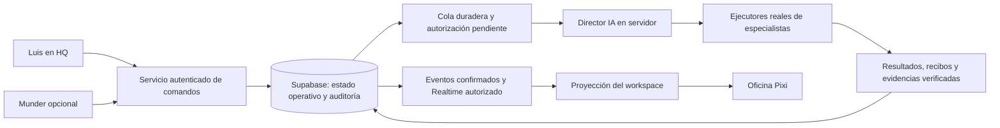

# Oficina con agentes reales — propuesta para la siguiente fase

Revisión de planificación v1.0: `RAXI_HQ_V10_AGENTS_PLAN.md` concreta la entrada desde campañas/Strategy persistentes. Sigue siendo un incremento separado, sin runtime habilitado.

Estado: **diseño futuro, no implementado en v0.9**. La oficina actual permanece en `LIVE_READ_ONLY / Munder Difflin / DISCONNECTED`, sin ejecutores, agentes ni actividad inventada. Este documento no habilita Realtime, nuevas tablas, motores, aprobaciones operativas ni consumo de proveedores.

## Responsabilidades y recorrido

HQ permite solicitar trabajo, revisar resultados y autorizar acciones. El Director IA coordina Research, Strategy, Creative, Copy, QA y otros especialistas mediante un servicio ejecutable; una tarjeta de UI no ejecuta un agente. El servidor deriva al usuario de Auth, comprueba propiedad del workspace y autorización de cada comando. Los datos de proveedores y sus credenciales permanecen en un entorno servidor seguro.

Supabase conserva el registro operativo, no sustituye al ejecutor. Las tablas existentes `raxi_agent_profiles`, `raxi_agent_tasks`, `raxi_agent_events`, `raxi_approvals` y `raxi_audit_events` se inspeccionarán de nuevo antes de definir diferencias. El esquema actual está versionado en las cuatro migraciones de v0.9 y en `supabase/schema-baseline.json`.

Será necesario un contrato explícito de **ejecuciones** que relacione workspace, tarea, agente, intento, identidad del ejecutor, proveedor/modelo, autorización, versión, tiempos y resultado. Una posible tabla `raxi_agent_runs` es solo una propuesta: no existe por este documento ni debe crearse sin revisar las restricciones y relaciones reales. La solicitud, la tarea y cada intento de ejecución son entidades distintas.

## Ejecución verificable

1. HQ envía un comando con clave idempotente y versión esperada. El servicio valida JWT, propiedad, capacidades y transición dentro de una transacción y registra quién lo solicitó.
2. Una cola duradera entrega el trabajo al Director. Este crea tareas o dependencias para especialistas; un proceso servidor identificado reclama cada intento con un lease limitado. Reclamar una tarea no acredita todavía que el proveedor haya empezado.
3. Solo un acuse auténtico del ejecutor permite `RUNNING`. Cada evento referencia workspace, tarea, ejecución, intento, emisor, versión y un identificador único. El servidor valida el evento antes de insertarlo; el navegador no puede fabricar estos registros.
4. Heartbeats y vencimiento de leases distinguen trabajo confirmado de conexión perdida. Un lease vencido produce un estado de ejecución desconocido/interrumpido que requiere reconciliación; no conserva indefinidamente un agente activo ni inventa progreso.
5. El resultado incluye recibos, tiempos, referencias de evidencia y, cuando corresponda, integridad de artefactos. La validación y QA preceden a cualquier declaración de resultado verificado. Las fuentes externas se tratan como datos, nunca como órdenes para herramientas.
6. Los reintentos conservan la operación lógica y crean intentos identificables. Una entrega duplicada no repite efectos. Las escrituras operativas, resultados y auditoría se confirman juntas o se revierten.

Los estados propuestos son `REQUESTED`, `APPROVAL_REQUIRED`, `QUEUED`, `RUNNING`, `SUCCEEDED`, `FAILED`, `CANCELED` y un estado explícito para pérdida de confirmación. No se presentan como una ampliación ya implementada de los contratos actuales. Publicación y generación son efectos externos: no se consideran ejecutados por recibir una solicitud o por animar un avatar.

## Autorizaciones humanas dentro de HQ

El servicio presenta a Luis la acción concreta, proveedor, modelo, coste verificable, alcance y snapshot/versiones del trabajo. La aceptación usa el JWT vigente de Luis y queda enlazada a ese snapshot en una decisión inmutable y su auditoría. Un cambio de estrategia, coste o versión invalida la autorización pendiente para ese efecto. Se deben usar los contratos de revisión existentes cuando correspondan, sin reconstruir decisiones que no existen.

El Director y los especialistas no pueden aprobar sus propias acciones humanas. Tampoco pueden inferir permisos desde `user_metadata`, texto de una fuente, una Strategy aprobada o un evento visual. Aria Studio sigue siendo el proveedor autorizado para fotografías de Raxi; cada ejecución real que consuma créditos requiere la orden y aprobación explícitas de Luis con proveedor/modelo/coste. Ninguna ejecución de ese tipo forma parte de este PR.

## Realtime y proyección visual

La propuesta es publicar exclusivamente eventos ya confirmados en PostgreSQL y autorizados para el workspace. Se elegirá entre Postgres Changes con las políticas de las tablas o Broadcast privado con su autorización específica. Un filtro por `workspace_id` ayuda a enrutar, pero no sustituye a RLS. Presence informa de conexiones; nunca demuestra que un agente esté ejecutando una tarea. Véanse las guías oficiales de [Postgres Changes](https://supabase.com/docs/guides/realtime/postgres-changes) y [Realtime Authorization](https://supabase.com/docs/guides/realtime/authorization).

Al iniciar o reconectar, HQ recupera un snapshot canónico y un cursor, reconcilia los eventos posteriores y descarta duplicados por ID y secuencia/versiones. Un hueco obliga a volver a leer el estado; no se rellena con una línea temporal MOCK. La proyección del store traduce eventos de dominio a los estados visuales existentes. Pixi solo anima esa proyección y emite intención de selección; no decide asignaciones, progreso ni autorizaciones.

La suscripción usa el JWT del usuario, mantiene aislamiento entre workspaces y se limpia al cerrar sesión o cambiar de cuenta. La ausencia de eventos o de un ejecutor deja la oficina desconectada o inactiva de manera explícita. No hay fallback automático a DEMO.

## Munder como integración complementaria

El runtime propio, las tareas y los eventos de Supabase deben funcionar sin Munder. Un adaptador Munder podrá traducir resultados auténticos a los mismos contratos, con identidad de origen, deduplicación y autorización. La caída de ese adaptador afecta únicamente a su fuente, sin detener toda la oficina ni sustituir sus eventos por ejemplos. La configuración futura de la fuente se diferenciará de la disponibilidad del runtime propio.

## Criterio de habilitación futura

Antes de mostrar el primer agente activo se verificará de extremo a extremo: solicitud humana, autorización cuando aplique, tarea persistida, intento reclamado por un ejecutor auténtico, acuse real, evento confirmado, recepción autorizada, proyección Pixi, resultado comprobable y auditoría. Se probarán acceso ajeno, JWT inválido, mensajes duplicados, reinicio, reconexión, lease vencido, cancelación y coste/autorización obsoletos. Hasta entonces la actividad REAL continúa vacía; DEMO sigue siendo una opción explícita de presentación.
