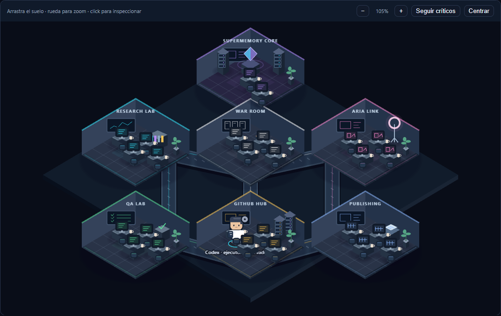
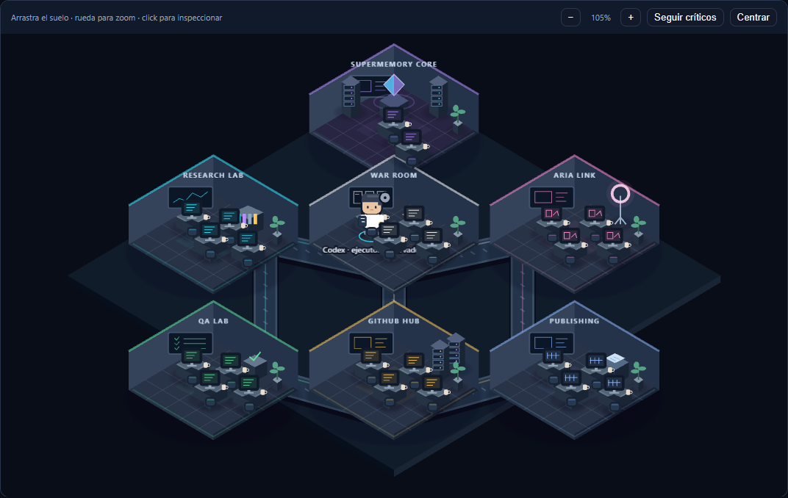

# Validación del observador de ejecuciones — PR #18

Base verificada: `1ec48d7509bb44de84265d2ee77fa9ed8f8d339c` (merge de #17). Checkout y rama independientes. **Resultado: avance histórico parcial; LIVE no habilitado ni acreditado.**

## Resultados comprobados

| Validación | Resultado |
| --- | --- |
| `npm ci --ignore-scripts --no-audit` | PASS, lockfile sin cambios, 166 paquetes instalados |
| `npm test` | **524/524 PASS**, 0 fallos, 0 skipped; incluye PostgreSQL local PGlite y regresiones previas |
| Nuevas regresiones de observación incluidas en la suite | **26 PASS** |
| `node --test tests/stagingSafety.test.mjs` desde apps/raxi-hq | **1/1 PASS**, guard local, sin conexión a staging |
| Total | **525 PASS** |
| `npm run build` | PASS, verificación de bundle campaign-command + TypeScript frontend/servidor + Vite |
| `npm run typecheck` | PASS |
| `npm audit --json` | 0 vulnerabilidades en todos los niveles |
| QA Chromium headless | PASS: App montada, OfficeScene/Pixi reales, escritorio 1440×1000; móvil 390×800 y 320×800 |
| Navegación / conexión | DEMO → REAL elimina la reproducción; fuente desconectada deja 0 avatares; 1 canvas |
| Red en el ensayo visual | 0 solicitudes externas; solo servidor Vite local |
| Errores de página en QA visual | 0 |
| Git | diff revisado, sin whitespace errors; diez eliminaciones originales intactas por comparación binaria del status |

La primera auditoría de npm falló por confianza de certificados. Se repitió con `NODE_USE_SYSTEM_CA=1` y validación TLS activa: PASS. No se deshabilitó TLS. Browser Use y Computer Use no pudieron inicializarse (`failed to write kernel assets`); se utilizó Chromium headless ya instalado con Playwright ya disponible, sin instalar navegadores ni servicios.

Los avisos de deprecación de react-test-renderer son del framework existente y no son fallos de la suite. No se ejecutó una auditoría exhaustiva mediante un servicio de IA; la revisión de seguridad consistió en inspección del diff, límites/procedencia/capacidades, regresiones, escaneo local de secretos staged y npm audit.

## Qué demuestran las regresiones

- Captura auténtica fijada por SHA-256 y referencias de campos nativos; texto alterado y propiedades desconocidas rechazados.
- Origen, proyecto, thread, run, ejecutor, modalidad o asignaciones inventadas rechazados.
- Fechas inválidas, iguales y desordenadas rechazadas; no se repara ni ordena la evidencia.
- Estado parcial, aprobación pendiente, error o estado desconocido no observado rechazado; no se convierte en actividad actual.
- Proyección sin admisión rechazada; valores admitidos congelados.
- Un evento histórico provoca movimiento finito en AgentMotion existente; finalización devuelve a reposo. No aparecen task ID, handoffs, capacidades ni agente Raxi inventados.
- Carga concurrente, finalización repetida y respuesta de una fuente anterior no duplican eventos ni reemplazan la selección posterior.
- Logout, cambio de usuario/proyecto, desmontaje, remount y REAL/DEMO eliminan la observación e invalidan la admisión tardía.
- Sin evidencia/conexión no hay avatar, movimiento ni fallback MOCK. Cero fetch/proveedor y cero intervalos en el observador.
- App montada en StrictMode mantiene el rótulo histórico y el botón de conexión live deshabilitado.

## Evidencia visual e identidad

Ejecución comprobada mediante `read_thread`: `01a1701c-eac4-77b3-9075-1abe7031876d`, thread `01a1559f-dfe9-7d31-90d3-b4fff0820615`. Inicio 2026-10-24 22:51:46 UTC; finalización 22:57:11 UTC. Ejecutor Codex externo, **sin atribución al Director o Investigador**.

El harness monta App, AuthProvider y OfficeScene existentes. Auth y repositorios son **dobles locales identificados** que bloquean escrituras; no acreditan Auth alojado, RLS, persistencia de recibos o nuevas actividades de producción. La evidencia histórica de ejecución procede del historial auténtico, no de esos dobles. Los dos eventos son observaciones derivadas de timestamps del turno, no mensajes push recibidos en vivo.

[Captura móvil inspeccionada](execution-observer/observer-mobile-390.png). No hubo overflow horizontal en 390 o 320 píxeles. Metadatos y SHA-256 de capturas: [validation.json](execution-observer/validation.json).

## Límites y aceptación pendiente

No hay integración live ni suscripción desktop accesible verificada; por ello la aceptación principal de actividad en vivo permanece **BLOQUEADA**. No se acredita acceso API, workers, ejecución de agentes Raxi, tareas/recibos duraderos, permisos alojados o resultados del modelo. El histórico tampoco demuestra estados de aprobación, progreso, resultados o errores que no figuran en la captura.

Reproducción y diseño del puente futuro: [documento técnico](../../../docs/RAXI_HQ_EXECUTION_OBSERVER.md). Se mantiene el PR en borrador. Sin SQL, despliegues, proveedores, costes nuevos, imágenes generadas, publicaciones, cambios de Guardian o datos de producción.
